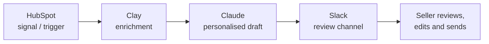

# AI Outbound Workflow

A signal-based outbound system I built and used as an enterprise seller. When a buying signal shows up in HubSpot, the account is enriched in Clay, Claude writes a personalised first touch, and the draft lands in Slack for me to review and send.

Built by **Madan Gopal Koushik**, Senior Enterprise Account Executive (data infrastructure, cloud, SaaS, cybersecurity).

---

## Why I built it

I sold in small, early-stage teams with no SDR support. Every hour spent researching an account was an hour not spent on calls or deals. I wanted outbound that:

- starts from a real signal, so the message has a reason to exist
- does the account research for me before I write anything
- keeps a human in the loop, so nothing goes out without my review

## How it works

1. **Trigger (HubSpot).** A workflow in HubSpot fires when a contact or company meets a signal condition. It passes the record to Clay.
2. **Enrich (Clay).** Clay fills in the context a good first message needs: company details, the person's role, and recent signals about the account.
3. **Personalise (Claude).** A prompt takes the enriched record and writes a short, specific opener tied to the signal and to the buyer's likely priorities.
4. **Review (Slack).** The draft is posted to a Slack channel with the key account facts next to it. I edit, approve, or skip.

## What's in this repo

| Folder | What it holds |
|---|---|
| [`prompts/`](prompts/) | The personalisation prompt and the rules it follows |
| [`clay/`](clay/) | The enrichment columns and what each one is used for |
| [`hubspot/`](hubspot/) | How the trigger workflow is set up |
| [`examples/`](examples/) | A sample run on a fictional company, from signal to Slack message |
| [`docs/setup-guide.md`](docs/setup-guide.md) | How to rebuild this in your own stack |

## Design choices

- **Signal first, message second.** No signal, no message. This keeps volume low and relevance high.
- **Human in the loop.** The AI drafts, the seller decides. Drafts go to Slack, not straight to a sequence.
- **Short messages.** The prompt caps the opener at a few sentences and bans generic flattery and buzzwords.
- **No customer data in this repo.** Everything here is rebuilt with fictional examples.

## Tools

HubSpot · Clay · Claude (Anthropic) · Slack

## Related

- [buying-signal-tracker](https://github.com/Madangk/buying-signal-tracker): the code version: ranks accounts by hiring signals from public job boards
- [enterprise-sales-playbook](https://github.com/Madangk/enterprise-sales-playbook): full-cycle enterprise sales playbook with talk tracks, templates and a coaching kit
- [account-research-agent](https://github.com/Madangk/account-research-agent): one-page account briefs with MEDDPICC discovery questions, built on Claude
- [meddpicc-deal-kit](https://github.com/Madangk/meddpicc-deal-kit): MEDDPICC scorecard, question bank and a Claude call-review prompt

## About me

9+ years of B2B sales across data infrastructure, cloud, SaaS and cybersecurity, selling to enterprise and BFSI buyers in India, APAC, the US and Europe. I build AI into my own sales process so I can spend more time with customers.

📫 [Connect with me on LinkedIn](https://www.linkedin.com/in/madankoushik/)
